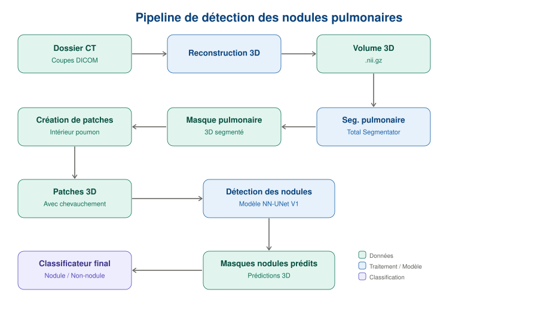

# Lung Nodule Detection on Chest CT: Nodulis

P2M project by Chehine Chaaben and Yesmine Haddar (SUP'COM).

An end-to-end pipeline that takes a chest CT as DICOM slices and produces segmented lung nodules, per-nodule measurements and a PDF report, served through a web platform with 2D and 3D visualization.



## Pipeline

| Step | What it does | Code |
|---|---|---|
| 1. Reconstruction | DICOM slices to a 3D NIfTI volume (SimpleITK, native spacing) | `construct_3d.py` |
| 2. Lung and lobe masks | TotalSegmentator, 5 lobes; restricts the search to the lungs | `lung_mask_from_volume.py` |
| 3. Nodule segmentation | nnU-Net v1 `3d_fullres` on overlapping 80×192×192 tiles inside the lungs, probability threshold 0.15 | `predict.py` |
| 4. False-positive reduction | Removes candidates under 3 mm, then a 3D CNN classifies a 32×48×48 crop around each candidate (keep if P(nodule) ≥ 0.2) | `nodule_filter_classifier/` |
| 5. Features | Geometry, HU statistics and PyRadiomics descriptors per nodule, lobe of each nodule | `nodules_and_features_extraction/` |
| 6. Platform and report | Flask API that runs steps 1 to 5 per case, React viewer (Niivue), ReportLab PDF report | `backend/`, `frontend/` |

## Repository layout

```
predict.py, construct_3d.py, lung_mask_from_volume.py   standalone inference (steps 1-3)
nodule_filter_classifier/          false-positive classifier (step 4)
nodules_and_features_extraction/   feature extraction (step 5), with an example output in nodule_results/
backend/                           Flask API; backend/pipeline/ holds the copies of each step the app runs
frontend/                          React + Vite + Tailwind interface
model/                             where the nnU-Net weights go (not in git, see model/README.md)
malignancy_scoring_wip/            benign/malignant scoring: code written, not trained yet
docs/                              pipeline diagram
data_preparation/                  LIDC-IDRI to nnU-Net dataset: scripts, exploration CSVs, guides (described below)
```

## Models

- **Nodule segmentation:** nnU-Net v1 (1.7.1), `3d_fullres`, `nnUNetTrainerV2`, trained on LIDC-IDRI prepared with the scripts below (50% reader consensus masks). Patch 96×160×160 at 1.25 × 0.70 × 0.70 mm, a single fold. The weights are not in the repository.
- **False-positive classifier:** a 3D CNN (4 convolutional blocks, 8 to 64 channels, about 222k parameters) that classifies a 32×48×48 crop around each candidate as nodule or non-nodule. The weights are not in the repository. See [nodule_filter_classifier/README.md](nodule_filter_classifier/README.md).
- **Lungs and lobes:** [TotalSegmentator](https://github.com/wasserth/TotalSegmentator), pretrained.

## Running

Put the weights in place first (see [model/README.md](model/README.md)).

Standalone inference on one DICOM folder:

```bash
pip install -r requirements-inference.txt
python predict.py --dicom_dir path/to/dicom_folder --case_id case_001
```

Web platform (backend on port 5000, frontend on port 5173, default login `admin` / `admin`):

```bash
cd backend
python -m venv venv
venv\Scripts\activate
pip install -r requirements.txt
python app.py
```

```bash
cd frontend
pnpm install
pnpm dev
```

Full setup notes, including the PyRadiomics install: [frontend/README.md](frontend/README.md).

## Status

- Done: data preparation, nnU-Net training, inference, false-positive filtering, feature extraction, web platform and PDF report.
- Not finished: malignancy scoring (`malignancy_scoring_wip/`), waiting for training.
- This is a research prototype, not a medical device.

---

# Part 1: Data preparation (LIDC-IDRI to nnU-Net)

This part documents the full path from raw LIDC-IDRI data to a training-ready nnU-Net segmentation dataset. The scripts, exploration CSVs and guides are in [data_preparation/](data_preparation/).

The original workflow started from a local LIDC-IDRI DICOM folder. That source folder is now moved away from this workspace for storage reasons, while derived artifacts and training-ready data remain here.

## 1. What This Project Achieved

1. Parsed and inspected mixed LIDC XML annotations (CT and CXR schemas).
2. Counted and audited CT series coverage and slice depth.
3. Reconstructed CT series into native-geometry NIfTI volumes.
4. Copied matching XML annotations alongside reconstructed volumes.
5. Prepared nnU-Net v2 dataset format with binary nodule masks.
6. Produced QC and audit reports to support reliable training decisions.

## 2. Current Workspace State

Data present now:

- Derived CT volumes and copied XML: [outputs_native_full/](outputs_native_full/)
- nnU-Net raw datasets: [nnUNet_raw/](nnUNet_raw/)
- Main training dataset: [nnUNet_raw/Dataset104_LungNodule_Native/](nnUNet_raw/Dataset104_LungNodule_Native/)
- Analysis CSV outputs: [xml_metadata.csv](data_preparation/xml_metadata.csv), [ct_per_patient.csv](data_preparation/ct_per_patient.csv), [ct_slices_per_series.csv](data_preparation/ct_slices_per_series.csv), [ct_slices_per_patient_summary.csv](data_preparation/ct_slices_per_patient_summary.csv), [suspicious_missing_native_min50.csv](data_preparation/suspicious_missing_native_min50.csv)

Raw source note:

- The original LIDC-IDRI source folder is not currently in this workspace (moved to external storage to save disk space).
- Scripts that need raw DICOM/XML still work if you point them to the external source path.

## 3. Pipeline Phases (What Was Done)

## Phase A: Annotation and Metadata Exploration

Goal: understand what annotation content exists and separate CT-ready content from CXR content.

- [xml_viewer.py](data_preparation/xml_viewer.py): fast XML inspection and schema summary.
- [xml_to_csv.py](data_preparation/xml_to_csv.py): exports structured XML metadata into [xml_metadata.csv](data_preparation/xml_metadata.csv).
- [ct_count_per_patient.py](data_preparation/ct_count_per_patient.py): computes CT XML count per patient into [ct_per_patient.csv](data_preparation/ct_per_patient.csv).

Key point: LIDC includes both CT XML (LidcReadMessage) and CXR XML (IdriReadMessage). CT segmentation preparation uses CT-linked content.

## Phase B: CT Coverage and Slice-Density Audits

Goal: quantify which series are likely reconstructable CT volumes.

- [ct_slices_per_series.py](data_preparation/ct_slices_per_series.py): counts DICOM slices per series and writes [ct_slices_per_series.csv](data_preparation/ct_slices_per_series.csv) and [ct_slices_per_patient_summary.csv](data_preparation/ct_slices_per_patient_summary.csv).
- [find_suspicious.py](data_preparation/find_suspicious.py): flags expected CT series with at least 50 slices that are missing reconstructed outputs into [suspicious_missing_native_min50.csv](data_preparation/suspicious_missing_native_min50.csv).

Why this mattered: it gave a measurable check before and after reconstruction, and helped focus fixes on missing high-value series.

## Phase C: Native CT Reconstruction from DICOM

Goal: convert CT DICOM series to NIfTI while preserving scanner geometry.

- [reconstruct_3d_volume.py](data_preparation/reconstruct_3d_volume.py)
  - validates CT XML schema in series folder
  - reads DICOM series with SimpleITK
  - keeps native geometry (no forced resampling)
  - clips HU intensities (default -1000 to 400)
  - writes native int16 volume
- [batch.py](data_preparation/batch.py)
  - crawls patient/study/series folders
  - calls native reconstruction for each eligible series
  - copies XML files to output series folders
  - writes outputs under [outputs_native_full/](outputs_native_full/)

Why native geometry is important: it reduces avoidable geometric distortion before mask generation and training.

## Phase D: nnU-Net v2 Dataset Preparation

Goal: generate nnU-Net compatible imagesTr and labelsTr for segmentation training.

- [prepare_nnunet_lidc.py](data_preparation/prepare_nnunet_lidc.py)
  - discovers series folders containing NIfTI + XML
  - extracts SeriesInstanceUid from XML
  - matches scans via pylidc database
  - builds consensus binary nodule masks from reader annotations
  - stores labels as class 0 background, class 1 nodule
  - writes nnU-Net structure and metadata
  - writes audit reports for full traceability

Reference guide: [NNUNET_V2_PREP_GUIDE.md](data_preparation/NNUNET_V2_PREP_GUIDE.md)

## 4. Dataset104 (Current Main Training Dataset)

Location: [nnUNet_raw/Dataset104_LungNodule_Native/](nnUNet_raw/Dataset104_LungNodule_Native/)

Contents:

- images: [nnUNet_raw/Dataset104_LungNodule_Native/imagesTr/](nnUNet_raw/Dataset104_LungNodule_Native/imagesTr/)
- labels: [nnUNet_raw/Dataset104_LungNodule_Native/labelsTr/](nnUNet_raw/Dataset104_LungNodule_Native/labelsTr/)
- dataset metadata: [nnUNet_raw/Dataset104_LungNodule_Native/dataset.json](nnUNet_raw/Dataset104_LungNodule_Native/dataset.json)
- prep audit report: [nnUNet_raw/Dataset104_LungNodule_Native/prep_report_rebuild.csv](nnUNet_raw/Dataset104_LungNodule_Native/prep_report_rebuild.csv)
- resample QC report: [nnUNet_raw/Dataset104_LungNodule_Native/resampled_qc_rebuild.csv](nnUNet_raw/Dataset104_LungNodule_Native/resampled_qc_rebuild.csv)

Verified summary:

- numTraining in dataset.json: 918
- imagesTr files: 918
- labelsTr files: 918
- processed cases: 918
- skipped cases: 0
- errors: 0
- label classes: background 0, nodule 1
- zero-voxel labels: 121 (13.18 percent)
- nonzero labels: 797 (86.82 percent)
- nodule voxel stats across processed labels:
  - min: 0
  - median: 502
  - p90: 5754
  - max: 45440
- resample QC events: 0

## 5. Why Dataset104 Is Good for Your Segmentation Task

Dataset104 is a strong starting point for lung nodule segmentation training because:

1. It is nnU-Net compliant out of the box.
   - paired imagesTr and labelsTr with correct naming and channel suffixes.
2. It has substantial training volume.
   - 918 labeled training cases is a practical scale for robust model learning.
3. It includes positive and negative supervision.
   - 797 positive-label cases train lesion localization.
   - 121 empty-label cases train background discrimination and help control false positives.
4. It uses binary, clinically aligned target classes.
   - exactly one foreground class for nodule segmentation (simplifies objective and evaluation).
5. It is produced with auditability.
   - per-case prep report and QC report allow transparent debugging and reproducibility.
6. It preserves geometry consistency in this build.
   - no resampled mismatch events were recorded in this dataset generation run.

Practical implication: this mix is suitable for training a first strong baseline model and then iterating with targeted case filtering only if validation metrics indicate a need.

## 6. Script Catalog (Quick Reference)

- [xml_viewer.py](data_preparation/xml_viewer.py): inspect and summarize XML files.
- [xml_to_csv.py](data_preparation/xml_to_csv.py): export XML metadata into tabular CSV.
- [ct_count_per_patient.py](data_preparation/ct_count_per_patient.py): CT XML counts per patient.
- [ct_slices_per_series.py](data_preparation/ct_slices_per_series.py): DICOM slice counts per series and patient.
- [find_suspicious.py](data_preparation/find_suspicious.py): locate expected missing reconstructed series.
- [reconstruct_3d_volume.py](data_preparation/reconstruct_3d_volume.py): single-series native CT reconstruction.
- [batch.py](data_preparation/batch.py): bulk reconstruction plus XML copy into structured output tree.
- [prepare_nnunet_lidc.py](data_preparation/prepare_nnunet_lidc.py): prepare final nnU-Net dataset and reports.
- [display.py](data_preparation/display.py): quick DICOM slice visualization sanity check.

## 7. Reproducible Run Order (From Raw Source to Dataset)

If you reconnect the raw LIDC-IDRI source path:

1. XML exploration and exports
   - run [xml_viewer.py](data_preparation/xml_viewer.py)
   - run [xml_to_csv.py](data_preparation/xml_to_csv.py)
   - run [ct_count_per_patient.py](data_preparation/ct_count_per_patient.py)
2. Slice audits
   - run [ct_slices_per_series.py](data_preparation/ct_slices_per_series.py)
3. Native reconstruction
   - run [batch.py](data_preparation/batch.py) to generate [outputs_native_full/](outputs_native_full/)
4. Missing-series audit
   - run [find_suspicious.py](data_preparation/find_suspicious.py)
5. nnU-Net prep
   - run [prepare_nnunet_lidc.py](data_preparation/prepare_nnunet_lidc.py) into [nnUNet_raw/](nnUNet_raw/)

## 8. Environment and Dependencies

Dependencies are listed in [requirements.txt](data_preparation/requirements.txt), including:

- SimpleITK
- pydicom
- nibabel
- numpy
- pylidc
- tqdm
- matplotlib
- setuptools<81

Use your existing workspace virtual environment before running scripts.

## 9. Existing Guides in This Repository

- [DATA_GUIDE.md](data_preparation/DATA_GUIDE.md): data organization and XML schema context.
- [ANNOTATIONS_BEGINNER_GUIDE.md](data_preparation/ANNOTATIONS_BEGINNER_GUIDE.md): annotation concepts and terminology.
- [NNUNET_V2_PREP_GUIDE.md](data_preparation/NNUNET_V2_PREP_GUIDE.md): nnU-Net prep script usage and cautions.

## 10. What Came Next

The prepared dataset was used to train the nnU-Net nodule segmentation model used by the full pipeline described at the top of this README.
